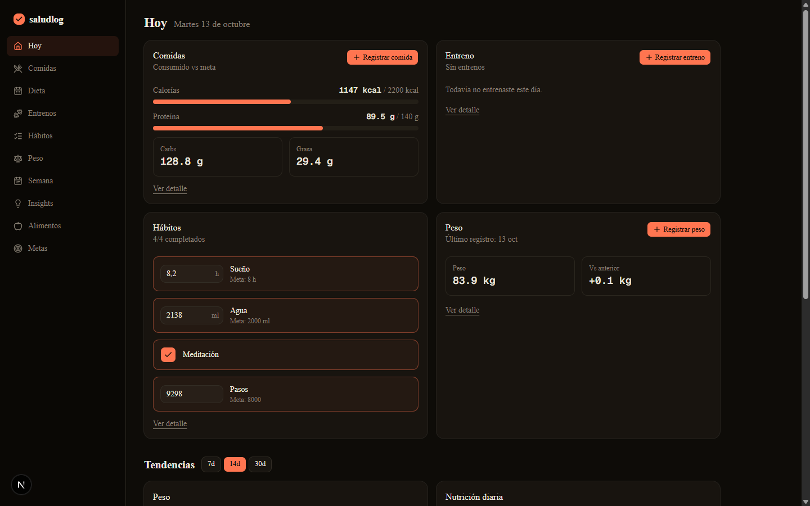

# saludlog

Local-first personal health tracker: meals with macros, workouts, body metrics and daily habits — plus weekly diet and training plans, trends and insights.

**100% local.** One SQLite file, no accounts, no cloud, no tracking. Your data never leaves your machine.



## Features

- **Dashboard** (`/`) — today at a glance vs your goals: calories/protein with progress bars, workouts, habits, latest weight with delta. `?date=` for past days. Trends over 7/14/30d: weight with moving average, daily nutrition, weekly training volume, habit adherence with streaks.
- **Meals** (`/meals`) — multi-item logging with live macros, daily history, one-click repeat. Food catalog (`/foods`) with import from OpenFoodFacts.
- **Diet plan** (`/plan`) — plan your whole week: 7 days × 4 meals, picked from the food catalog, with per-day macro totals.
- **Workouts** (`/workouts`) — weekly view with a set editor, reusable routines (browse 800+ exercises), and a weekly training plan that can apply a routine to a day in one click.
- **Habits** (`/habits`) — daily grid by unit (check / count / hours / ml) with configurable targets, ordering and pause.
- **Metrics** (`/metrics`) — weight, body fat %, waist; upsert by date.
- **Weekly report** (`/weekly`) — this week vs last: avg kcal, sessions, weight delta, habit %.
- **Insights** (`/insights`) — explicit rules over your own data: sleep vs calories, training weeks vs weight, habit consistency.
- **Export** — full JSON and per-domain CSV from `/settings`.
- **Bilingual** — Spanish and English UI, toggle in the sidebar, persisted via cookie.
- **PWA** — installable (manifest, icons, basic service worker). Dark and light themes.
- **Demo data** — `demo/saludlog-demo.db` ships a synthetic dataset for trying everything out.

## Stack

Next.js 16 (App Router, Server Components, Server Actions, Cache Components) · TypeScript strict · Drizzle ORM + better-sqlite3 · shadcn/ui (Base UI) + Tailwind v4 · Recharts · date-fns · zod

## Quickstart

```bash
npm install
npm run dev    # http://localhost:3000 — creates, migrates and seeds the DB on start
```

Your database lives at `data/saludlog.db` and is gitignored. To explore with fake data first, run `npm run db:seed:demo` or point `DB_FILE=demo/saludlog-demo.db` at the dev server.

## Scripts

| Command | What it does |
|---|---|
| `npm run dev` | dev server (auto-migrates + seeds) |
| `npm run build` / `lint` | production build / eslint |
| `npm run db:generate` | generate a migration from `src/db/schema.ts` |
| `npm run db:migrate` | apply pending migrations |
| `npm run db:seed` | default habits + base foods (idempotent) |
| `npm run db:seed:demo` | ~35 days of synthetic data for charts/insights |
| `npm run db:seed:exercises` | exercise catalog (free-exercise-db, ~800 exercises) |
| `npm run db:demo` | rebuild `demo/saludlog-demo.db` |

## Privacy

`data/`, `health/`, `*.db` and `.env*` are gitignored — the repo never tracks personal data. The only committed database is the synthetic demo. The app makes exactly one outbound call: an optional food search to the OpenFoodFacts public API, only when you hit "Search" in the food form.

## Contributing

See [CONTRIBUTING.md](CONTRIBUTING.md) · [Code of Conduct](CODE_OF_CONDUCT.md) · [Security](SECURITY.md)

## License

[MIT](LICENSE)
